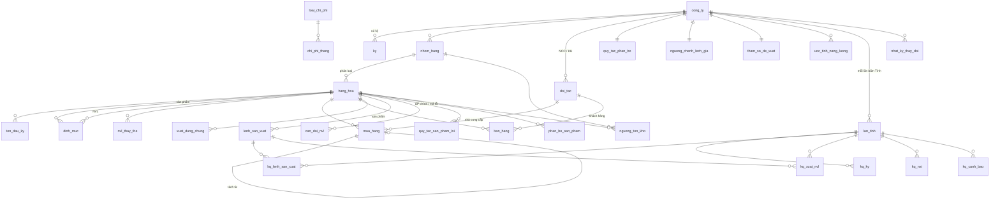

# Database – Phần mềm Giá thành (dựng từ mockup artifact Thiên Hồng)

Thư mục này chứa **database schema** cho hệ thống thật, được thiết kế từ chính bản mockup `artifact/index.html` (hệ thống giả lập).

Kèm theo là toàn bộ dữ liệu của mockup đã chuyển sang SQL:

- dữ liệu thật Thiên Hồng 2026;
- kết quả tính giá thành;
- công ty DEMO (dữ liệu mẫu đối chiếu Excel).

- **Hệ quản trị:** PostgreSQL 14 trở lên. Toàn bộ các tệp đã được chạy thử và kiểm tra trên PostgreSQL 16.
- **Đa công ty:** mọi bảng nghiệp vụ có cột `cong_ty_id`, nên một database dùng chung được cho Thiên Hồng, Thảo Vy, Dương Vân…
- **Schema:** `gia_thanh` (mọi bảng nằm trong schema này, không đụng `public`).

## 1. Các tệp

| Tệp | Nội dung |
|---|---|
| `01_schema.sql` | Tạo schema, kiểu liệt kê, 30 bảng, chỉ mục, ràng buộc, trigger chặn sửa kỳ đã khóa |
| `02_views.sql` | 7 view báo cáo (NXT, giá thành theo lệnh, tổng hợp bán hàng, chi phí tháng, rủi ro tồn kho…) |
| `03_du_lieu_thien_hong_2026.sql` | Dữ liệu Thiên Hồng T1–T10/2026 lấy từ bản sao lưu `data/SaoLuu_GiaThanh_2026-11-04.json` (công ty mã `TH`) |
| `04_ket_qua_tinh_thien_hong_2026.sql` | Kết quả 1 lần bấm "▶ Tính giá thành" trên mockup với dữ liệu trên |
| `05_du_lieu_demo_2026.sql` | Công ty `DEMO` – dữ liệu mẫu `data/demo_2026_seed.json` (khớp file Excel giá thành 2026) |
| `kiem_tra.sql` | Truy vấn kiểm tra sau khi nạp (đếm dòng, công thức 154 tự khớp) |
| `nap_database.sh` | Nạp tất cả theo đúng thứ tự |
| `cong_cu/json_sang_sql.py` | Chuyển **bất kỳ** tệp sao lưu `.json` của phần mềm → SQL (dùng cho công ty mới) |
| `cong_cu/xuat_ket_qua_tinh.js` | Chạy chính mockup (Playwright) để tính và xuất kết quả → JSON, rồi `json_sang_sql.py --ket-qua` đổi sang SQL |

Số dòng sau khi nạp (đã kiểm tra):

| | hàng hóa | định mức | mua hàng | bán hàng | lệnh SX | xuất dùng chung |
|---|---|---|---|---|---|---|
| TH | 25 | 24 | 251 (1 dòng tách HĐ) | 457 | 1.172 | 6 |
| DEMO | 24 | 24 | 250 | 457 | 1.172 | 6 |

Kết quả tính của TH có:

- 10 kỳ;
- 1.172 lệnh;
- 4.546 dòng xuất NVL;
- 250 dòng NXT.

Công thức 154 = 621 + 622 + 627 và giá thành nhập kho = 154 − thu hồi SP lỗi đều khớp 100%. Tổng 154 theo tháng cũng khớp tổng các lệnh.

## 2. Cách nạp

```bash
createdb gia_thanh
./nap_database.sh "postgresql://postgres@localhost:5432/gia_thanh"              # tất cả
./nap_database.sh "postgresql://postgres@localhost:5432/gia_thanh" --chi-schema # chỉ bảng trống
```

Muốn nạp dữ liệu của công ty khác:

1. Trong phần mềm, bấm **Sao lưu (.json)**.
2. Chạy:
   ```bash
   python3 cong_cu/json_sang_sql.py SaoLuu_CongTyMoi.json 03_du_lieu_cong_ty_moi.sql --ma-cong-ty TV --ten-cong-ty "Công ty Thảo Vy"
   psql "$DB" -f 03_du_lieu_cong_ty_moi.sql
   ```
3. Có thể thêm kết quả tính:
   ```bash
   cd cong_cu && npm i playwright   # nếu máy chưa có
   node xuat_ket_qua_tinh.js ../SaoLuu_CongTyMoi.json ket_qua.json
   python3 json_sang_sql.py ../SaoLuu_CongTyMoi.json /dev/null --ma-cong-ty TV --ket-qua ket_qua.json --ra-ket-qua ../04_ket_qua_cong_ty_moi.sql
   ```

## 3. Sơ đồ quan hệ (ERD)



Có 3 lớp dữ liệu, khớp với cách mockup vận hành:

1. **Dữ liệu nhập:** danh mục, định mức, mua, bán, xuất, chi phí, lệnh SX, thiết lập. Người dùng nhập hoặc tải Excel vào đây.
2. **Kết quả tính:** các bảng `lan_tinh`, `kq_*`.
   - Mockup tính lại toàn bộ mỗi lần mở hoặc bấm "Tính".
   - Hệ thống thật lưu mỗi lần tính thành 1 `lan_tinh`, để xem lại và so sánh được.
   - Báo cáo chỉ đọc lần tính có `la_hien_hanh = true`.
3. **View báo cáo** (`v_*`): đọc dữ liệu nhập kèm lần tính hiện hành.

## 4. Ánh xạ mockup → bảng

| Mockup (khóa lưu trữ `gt` / tab) | Bảng | Ghi chú |
|---|---|---|
| `settings.company, startKy, workYear, kt*` | `cong_ty` | `ky_bat_dau` = kỳ có số dư đầu |
| `settings.locked`, `settings.daDeXuat` | `ky.da_khoa`, `ky.da_de_xuat` | Trigger `chan_ky_da_khoa` chặn thêm/sửa/xóa chứng từ của kỳ đã khóa |
| `NHOM`, `PROD_NHOM`, `isFinal/isProd/isLoi` | `nhom_hang.loai` | `TP_DONG_GOI`, `TU_SAN_XUAT`, `SAN_PHAM_LOI`, `NVL_MUA` |
| `items` | `hang_hoa` | |
| `opening` | `ton_dau_ky` | |
| `bom` | `dinh_muc` | Định mức/SP = `sl_nvl_lan ÷ sl_tp_lan`; `sl_tp_lan > 1` = SX theo mẻ |
| `subs` (+ cột Mã thay thế của `bom`) | `nvl_thay_the` | |
| `cal` | `lich_lam_viec` | |
| tên NCC / khách trên chứng từ | `doi_tac` | Chuẩn hóa; vẫn giữ chữ gốc ở `ten_nha_cung_cap`, `ten_khach_hang` |
| `p_YYYY-MM` | `mua_hang` | `ky` tự sinh từ ngày nhập kho; dòng "✂ Tách" nối về dòng gốc qua `tach_tu_id` |
| `s_YYYY-MM` | `ban_hang` | `ky` theo ngày hóa đơn |
| `i_YYYY-MM` | `xuat_dung_chung` | `CPSX_627` vào giá thành; `BAN_HANG_641` chỉ trừ kho |
| `COSTCOLS0` / `settings.costCols` | `loai_chi_phi` | Cột chi phí cấu hình được |
| `c_YYYY-MM` | `chi_phi_thang` | |
| `o_YYYY-MM.rows` | `lenh_san_xuat` | `ky` theo ngày xuất NVL. Cột `nguon`: Excel / PM / PM+tay / Tay / Excel+tay. `sl_goc` dùng cho hoàn tác "Bù hao hụt SP lỗi" |
| `o_YYYY-MM.adj` | `can_doi_nvl` | Khớp theo (ngày SX + mã SP + mã VT) |
| `settings.alloc` | `quy_tac_phan_bo`, `phan_bo_san_pham` | CĐ1 theo tỷ lệ cố định; CĐ2 theo tỷ trọng 621 |
| `settings.nguong` | `nguong_ton_kho` | Theo nhóm **hoặc** theo mã (mã ưu tiên) |
| `settings.giaNg` | `nguong_chenh_lech_gia` | |
| `settings.spLoi` | `quy_tac_san_pham_loi` | VAS 02 – SP hỏng trong định mức |
| `settings.planPrm` | `tham_so_de_xuat`, `uoc_tinh_nang_luong` | |
| `calc()` → `periods[ky]` | `kq_ky` | |
| `calc()` → `orders` | `kq_lenh_san_xuat` | |
| `calc()` → `orders[].lines` | `kq_xuat_nvl` | |
| `calc()` → `nxt` | `kq_nxt` | |
| `calc()` → `warnings` | `kq_canh_bao` | |

## 5. Quy tắc tính

Hệ thống thật cần lập trình lại các quy tắc tính sau. Chi tiết nằm ở `docs/02_QUY_DINH_NGHIEP_VU_VA_CONG_THUC.md`.

- **Kỳ tính:**
  - mua hàng theo `ngay_nhap_kho`;
  - lệnh SX theo `ngay_xuat_nvl`;
  - bán hàng theo `ngay_hoa_don`.
- **621:** SL theo ĐM = định mức × SL thực hiện (theo mẻ nếu SX theo mẻ). Cộng `can_doi_nvl`, rồi nhân với giá BQ tháng của NVL.
- **622/627:**
  - CĐ1 (`BT`) lấy `ty_le_cd1_*`, chia theo `phan_bo_san_pham`.
  - CĐ2 (`TP`) lấy phần còn lại, chia theo tỷ trọng 621 trong tháng.
  - `xuat_dung_chung` loại 627 được cộng vào 627.
- **154** = 621 + 622 + 627.
- **Sản phẩm lỗi:**
  - SL lỗi = SL thực hiện × `ty_le_loi`.
  - Thu hồi = SL lỗi × `gia_ban_uoc_tinh`.
  - Giá thành nhập kho = 154 − thu hồi.
  - Giá đơn vị = giá thành nhập kho ÷ SL đạt.
  - Mã lỗi nhập kho theo giá thu hồi.
- **Giá vốn:** bình quân tháng, (tồn đầu + nhập) ÷ (SL tồn đầu + SL nhập). Áp cho xuất SX, bán hàng và xuất dùng chung.
- **Rủi ro tồn kho:**
  - Số ngày còn dùng = tồn cuối ÷ BQ dùng/ngày.
  - So với `nguong_ton_kho`: trên mốc là `RUI_RO_CAO`, trên ½ mốc là `CANH_BAO`, tồn âm là "Âm kho – xử lý ngay".

## 6. Từ điển dữ liệu

Mỗi bảng và cột quan trọng đều có `COMMENT` ngay trong `01_schema.sql`. Có thể xem trực tiếp bằng `\d+ gia_thanh.<bảng>` trong psql, hoặc trong công cụ như DBeaver.

Quy ước đặt tên:

- tên bảng và cột bằng tiếng Việt không dấu, dạng snake_case;
- tiền dùng `numeric(18,2..4)`;
- số lượng dùng `numeric(18,6)`;
- kỳ là kiểu `date`, luôn là ngày 01 của tháng.

> ⚠ Repo đang **công khai**. Các tệp `03_…` và `04_…` chứa dữ liệu kinh doanh thật của Thiên Hồng (NCC, khách hàng, giá mua/bán). Hãy chuyển repo sang Private nếu không muốn công khai các dữ liệu này.
