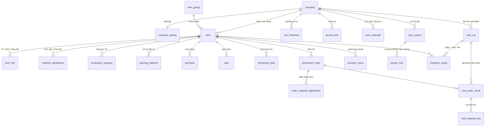

# Sơ đồ quan hệ (ERD) – schema `giathanh`

Đa công ty: `company` ở gốc; mọi bảng nghiệp vụ có `company_id` và khóa ngoại ghép `(company_id, mã hàng)` về `item`, để dữ liệu hai công ty không lẫn vào nhau.

## Nhóm bảng
| Nhóm | Bảng |
|---|---|
| Công ty và thiết lập | `company`, `company_setting`, `cost_column`, `risk_threshold`, `period_lock`, `work_calendar` |
| Dữ liệu nền | `item_group`, `item`, `bom_line`, `material_substitution`, `production_capacity`, `opening_balance` |
| Phát sinh hằng ngày | `purchase`, `sale`, `production_plan`, `production_order`, `order_material_adjustment`, `common_issue`, `period_cost` |
| Kết quả tính (snapshot) | `cost_run`, `cost_order_result`, `cost_material_line`, `inventory_result` |
| View | `v_item_has_bom`, `v_period_cost_summary`, `v_purchase_without_invoice` |

## Luồng dữ liệu
Dữ liệu nền + phát sinh → phần mềm tính (giá vốn bình quân, 621 từ định mức, phân bổ 622 / 627) → ghi kết quả vào nhóm *Kết quả tính*. Khóa kỳ lưu bản chốt (`cost_run.is_locked_snapshot = true`) và dòng ở `period_lock`.
