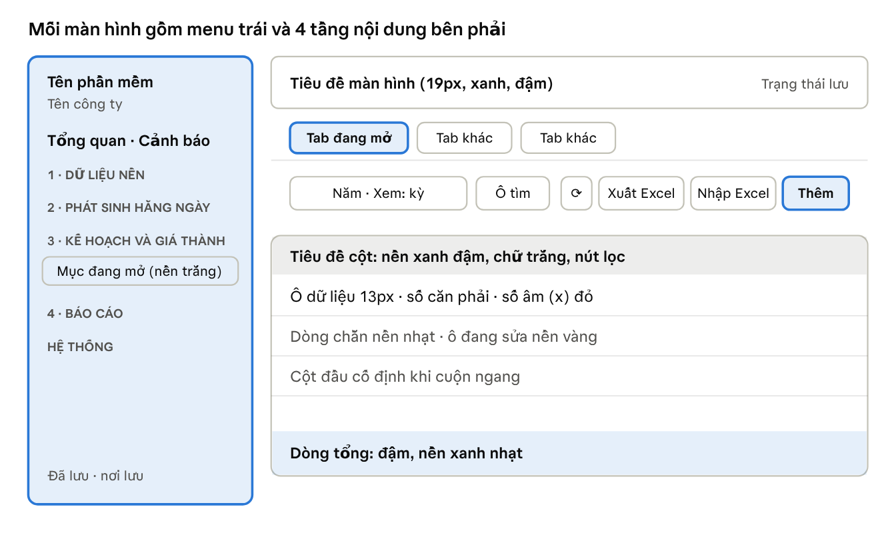

# Quy chuẩn giao diện – Phần mềm Giá thành Dương Vân

Nov 19, 2026 · @Lực

## 1. Bố cục chung

Màn hình nào cũng cùng một khung: **menu cố định bên trái**, bên phải xếp 4 tầng từ trên xuống.

bố cục một màn hình · menu trái + 4 tầng

1.  **Thanh tiêu đề**: nền trắng, kẻ dưới, dính trên cùng khi cuộn; trái là tiêu đề màn hình, phải là trạng thái lưu.

2.  **Hàng tab** (nếu màn hình có nhiều bảng), ngay dưới thanh tiêu đề.

3.  **Thanh công cụ**: trái là khung chọn kỳ, dưới nó là ô tìm; phải là các nút chức năng, nút chính màu xanh luôn cuối cùng.

4.  **Bảng dữ liệu** (hoặc thẻ số ở Tổng quan), cuộn trong khung, có dòng tổng cuối.

Vùng nội dung nền \#f4f6f9, cách lề 16px trên dưới và 22px hai bên. Phần mềm là 1 file HTML, chạy trên trình duyệt, dữ liệu lưu trên tài khoản Claude.

## 2. Font chữ, cỡ chữ, màu sắc

Toàn phần mềm dùng **một font hệ thống**, chữ số dạng đều cột (tabular-nums) để các cột số thẳng hàng.

| Thành phần                       | Font                               | Cỡ chữ                          | Đậm    | Màu                 |
|----------------------------------|------------------------------------|---------------------------------|--------|---------------------|
| Chữ thường (nội dung, nút, menu) | system-ui, Segoe UI, Roboto, Arial | 14px                            | Thường | \#1f2937            |
| Chữ trong bảng                   | như trên                           | 13px                            | Thường | \#1f2937            |
| Chữ phụ (ghi chú, nhãn thẻ)      | như trên                           | 12,5px                          | Thường | \#6b7280            |
| Chữ rất nhỏ (nhãn pill)          | như trên                           | 11,5px                          | Thường | \#6b7280            |
| Tên phần mềm trên menu           | như trên                           | 18px                            | 600    | \#ffffff            |
| Tên nhóm menu                    | như trên                           | 11px, VIẾT HOA, giãn chữ 0,04em | 700    | Màu riêng từng nhóm |
| Tiêu đề màn hình                 | như trên                           | 19px                            | 700    | \#1d4ed8            |
| Tiêu đề hộp thoại                | như trên                           | 15px                            | 600    | \#1f2937            |
| Số lớn trên thẻ tổng quan        | như trên                           | 21px                            | 600    | \#1f2937            |

**Bảng màu dùng chung**

| Tên              | Mã màu   | Dùng cho                                 |
|------------------|----------|------------------------------------------|
| Nền trang        | \#f4f6f9 | Nền vùng nội dung                        |
| Nền thẻ, bảng    | \#ffffff | Thẻ, bảng, thanh tiêu đề                 |
| Đường kẻ         | \#e3e7ee | Viền thẻ, viền khung bảng, gạch dưới tab |
| Viền ô nhập, nút | \#cbd3df | Ô nhập, nút trắng                        |
| Chữ chính        | \#1f2937 | Nội dung                                 |
| Chữ mờ           | \#6b7280 | Ghi chú, nhãn phụ                        |
| Màu chính (xanh) | \#1d4ed8 | Tiêu đề màn hình, nút chính, tab, link   |
| Xanh nhạt        | \#e8efff | Dòng tổng, nền chọn                      |
| Menu trái        | \#0f2a57 | Nền thanh menu                           |
| Xanh lá (đạt)    | \#15803d | Trạng thái tốt, nút đã làm xong          |
| Cam (cảnh báo)   | \#b45309 | Cảnh báo                                 |
| Đỏ (lỗi, số âm)  | \#b91c1c | Lỗi, số âm, nút xóa                      |
| Vàng ô nhập      | \#fff7cc | Ô đang được sửa                          |

Tất cả màu và cỡ chữ đặt một chỗ ở đầu file (biến --font, --fs, --fs-t, --pri, --nav…). Đổi một biến là cả phần mềm đổi theo.

## 3. Cấu trúc menu

Menu nằm bên trái, rộng 236px, nền \#0f2a57, chia **2 mục đầu + 5 nhóm**. Mỗi nhóm có ô vuông màu riêng trước tên nhóm và đánh số theo thứ tự công việc.

| Nhóm                     | Màu ô nhóm            | Các mục (theo thứ tự)                                                                         |
|--------------------------|-----------------------|-----------------------------------------------------------------------------------------------|
| (Đầu menu, chữ đậm)      | –                     | Tổng quan · Cảnh báo & kiểm tra                                                               |
| 1 · Dữ liệu nền          | \#5eead4 (xanh ngọc)  | Danh mục hàng · Số dư NXT đầu kỳ · Định mức · NVL thay thế                                    |
| 2 · Phát sinh hằng ngày  | \#fcd34d (vàng)       | Mua hàng & Bán hàng · Gia công ngoài · Xuất dùng chung · Chi phí 622/627                      |
| 3 · Kế hoạch & giá thành | \#86efac (xanh lá)    | Luồng xử lý · Đề xuất sản xuất · Lệnh sản xuất · Cân đối NVL · Giá thành                      |
| 4 · Báo cáo              | \#93c5fd (xanh dương) | Nhập – Xuất – Tồn · Tổng hợp bán hàng theo mặt hàng · Tổng hợp năm · File tải dữ liệu kế toán |
| Hệ thống                 | \#cbd5e1 (xám)        | Thiết lập & sao lưu · Hướng dẫn                                                               |

**Quy ước hiển thị menu**

- Đầu menu: tên phần mềm 18px trắng, dưới là tên công ty 12,5px màu \#9fb3d6.

- Tên nhóm: 11px, viết hoa, đậm, cách trên 16px; ô vuông 9×9px bo góc 3px cùng màu nhóm.

- Mục menu: chữ 14px màu \#dbe4f5, đệm 7×10px, bo góc 7px. Mục đang mở: nền trắng, chữ màu menu (#0f2a57), đậm 600.

- Hai mục đầu (Tổng quan, Cảnh báo) chữ trắng đậm. Mục có việc cần làm có số đếm nhỏ bên phải (ví dụ Đề xuất sản xuất).

- Cuối menu: dòng trạng thái lưu dữ liệu (✔ Đã lưu / ⏳ Đang lưu / ⚠ Lỗi lưu) và nơi lưu.

- Bấm mục khác khi đang sửa dở dòng: phần mềm hỏi lưu trước khi chuyển.

## 4. Nút chức năng

Mọi nút chức năng của màn hình nằm **bên phải thanh công cụ**, luôn hiện (không ẩn khi chưa cần). Màu nút cho biết loại việc.

| Kiểu nút           | Trông như thế nào                                                | Dùng cho                                              | Ví dụ                                                     |
|--------------------|------------------------------------------------------------------|-------------------------------------------------------|-----------------------------------------------------------|
| Nút thường         | Nền trắng, viền \#cbd3df, chữ đen, biểu tượng xanh 16px bên trái | Việc phụ                                              | Xuất Excel, Nhập Excel, Kiểm tra mã, ↩ Bỏ chuyển kho (16) |
| Nút chính (xanh)   | Nền \#1d4ed8, chữ và biểu tượng trắng                            | Việc chính của màn hình, luôn đứng cuối cùng bên phải | Thêm, Lưu, Sửa, Xuất Excel (ở màn hình chỉ để xuất)       |
| Nút chạy (xanh lá) | Nền \#16a34a, chữ trắng                                          | Chạy tính toán; bước đã làm xong có dấu ✓             | ▶ Tính giá thành, ✓ Đã chuyển ngày nhập kho               |
| Nút cần làm (cam)  | Nền \#f97316, chữ trắng, đánh số ① ② theo thứ tự                 | Bước xử lý chưa làm; làm xong chuyển sang xanh lá ✓   | ① 📅 Chuyển ngày nhập kho, ② ⚙ Cân đối NVL                |
| Nút khóa (vàng)    | Nền \#facc15, chữ nâu; đã khóa thì vàng đậm \#ca8a04 chữ trắng   | Khóa / mở khóa kỳ                                     | 🔒 Khóa kỳ, 🔒 Tháng này đã khóa                          |
| Nút xóa            | Như nút thường, chữ và biểu tượng đỏ \#b91c1c                    | Xóa; chỉ hiện khi đã tick chọn dòng                   | Xóa 3 dòng                                                |
| Nút biểu tượng     | Chỉ có hình 17px, vuông, di chuột hiện tên                       | Việc hay dùng, không cần chữ                          | Làm mới dữ liệu, Thiết lập bảng, Cột chi phí              |
| Nút nhỏ trong dòng | Đệm 3×8px, chữ 12,5px                                            | Thao tác trên 1 dòng của bảng                         | ✂ Tách, sửa, xóa dòng                                     |
| Nút chọn lọc       | Khung trắng cao 34px, rộng tối thiểu 130px, mũi tên ▾ bên phải   | Chọn nhóm / kho để xem                                | Nhóm: Tất cả ▾, Kho: Tất cả ▾                             |

**Kích thước chung:** cao khoảng 34px, đệm 6×11px, bo góc 7px, chữ 14px, không xuống dòng, cách nhau 8px. Di chuột lên nút thì nền đậm hơn một bậc. Nút nào cũng có dòng giải thích khi di chuột (title).

**Thứ tự nút bên phải, từ trái sang phải:**

1.  Xóa N dòng (chỉ khi có dòng được chọn)

2.  Nút nghiệp vụ riêng của màn hình (↩ Bỏ chuyển kho, ①, ②, ⚙ Tạo lô…)

3.  ⟳ Làm mới dữ liệu (biểu tượng)

4.  🔒 Khóa kỳ (chỉ ở Tổng quan) / ▶ Tính giá thành (chỉ ở Giá thành)

5.  Thiết lập bảng (biểu tượng)

6.  Xuất Excel

7.  Nhập Excel

8.  **Thêm** (xanh, luôn cuối)

**Bên trái thanh công cụ** là khung chọn kỳ (Năm · Xem: Cả năm / Tháng 1…12 / Khoảng tháng) và ô Tìm (rộng 170–220px, cao 34px). Ô tìm chỉ áp dụng cho tab đang mở.

## 5. Tab và tab con

Một màn hình có nhiều bảng thì chia **tab** ngay dưới thanh tiêu đề, trên thanh công cụ. Tab đang mở nổi bật màu cam để người dùng biết mình đang ở đâu.

| Trạng thái  | Chữ                       | Nền                                    | Gạch dưới        |
|-------------|---------------------------|----------------------------------------|------------------|
| Tab thường  | Xanh \#1d4ed8, đậm 600    | Không nền (di chuột: \#eef4ff)         | Không            |
| Tab đang mở | Cam đậm \#c2410c, đậm 600 | Cam nhạt \#ffedd5 (di chuột: \#fed7aa) | 2px cam \#ea580c |

- Tab đệm 7×12px, bo 2 góc trên 8px, cách nhau 4px; cả hàng tab có đường kẻ dưới \#e3e7ee.

- Tên tab có thể có ký hiệu đầu dòng: ▦ danh sách, ∑ tổng hợp, ☰ chi tiết, ⬇ nhập, ⬆ xuất.

- Tab có việc cần xử lý ghi số đỏ trong ngoặc, ví dụ “File tải hóa đơn chuyển ngày nhập kho (2 lệch)”.

- **Tab con** (nhiều phần trong 1 tab): dùng hàng nút nhỏ ngay trên bảng, nút đang chọn màu xanh chính. Ví dụ tab File tải hóa đơn chuyển ngày nhập kho có 4 nút: Mua hàng trong nước · Nghiệp vụ khác · DS HĐ chuyển ngày · Đối chiếu HĐ.

- Nút của thanh công cụ đổi theo tab (ví dụ tab tổng hợp chỉ có Xuất Excel, không có Thêm).

- Phần mềm nhớ tab đang mở của từng màn hình; quay lại màn hình thì mở đúng tab cũ.

Các màn hình có tab: Cảnh báo & kiểm tra (3), Danh mục hàng (2), Mua hàng & Bán hàng (2), Cân đối NVL (2), Giá thành (5), Nhập – Xuất – Tồn (2), File tải dữ liệu kế toán (3), Thiết lập & sao lưu (3).

## 6. Bảng dữ liệu

Mọi màn hình nhập liệu và báo cáo dùng **chung một kiểu bảng**. Mỗi tab chỉ cần khai báo danh sách cột (tên, kiểu số hay ngày, độ rộng, cột bắt buộc, cột cộng tổng), phần hiển thị, lọc, xuất Excel tự có.

| Bộ phận            | Quy ước                                                                                                                                          |
|--------------------|--------------------------------------------------------------------------------------------------------------------------------------------------|
| Khung bảng         | Viền \#e3e7ee, bo 8px, cao tối đa 70% màn hình, cuộn trong khung                                                                                 |
| Tiêu đề cột        | Nền xanh đậm chuyển màu \#2b4c8c → \#1f3b70, chữ trắng, căn giữa (kể cả cột số), được xuống dòng, rộng tối thiểu 110px; cố định khi cuộn dọc     |
| Nút lọc ▼          | Ô nhỏ trắng ở góc phải tiêu đề. Cột đang lọc: tiêu đề chuyển nâu cam \#b45309 → \#92400e, nút lọc nền vàng                                       |
| Bộ lọc             | Kiểu Excel: sắp xếp tăng/giảm, tick chọn giá trị, lọc số (lớn hơn, nhỏ hơn, trong khoảng…, hiểu được số âm dạng (x)), lọc chữ, lọc ngày          |
| Độ rộng cột        | Kéo mép phải tiêu đề để đổi, phần mềm nhớ lại                                                                                                    |
| Dấu trên tiêu đề   | \* = bắt buộc nhập; ⓘ = di chuột xem giải thích                                                                                                  |
| Cột đầu tiên       | Cố định khi cuộn ngang. Bảng nhập liệu có cột tick chọn rộng 36px để xóa nhiều dòng                                                              |
| Thiết lập bảng     | Ẩn/hiện cột, chọn số cột cố định bên trái (đường kẻ 2px xanh \#8aa4cf ngăn cách)                                                                 |
| Ô dữ liệu          | Chữ 13px, đệm 5×8px, kẻ \#dde3ec, 1 dòng, dài quá 260px thì hiện “…”                                                                             |
| Dòng chẵn          | Nền \#f7f9fc (kẻ sọc)                                                                                                                            |
| Ô đang sửa         | Nền vàng \#fff7cc, viền xanh 2px khi đang gõ; thanh tiêu đề hiện nhãn “✎ Đang sửa – nhớ bấm Lưu”                                                 |
| Ô bấm xem chi tiết | Chữ xanh \#1d4ed8, đậm, gạch chân xanh nhạt                                                                                                      |
| Cột tính thêm      | Cột phần mềm tự tính (Tên hàng, ĐVT, Tổng thanh toán…) xen ngay sau cột gốc, không sửa được                                                      |
| Dòng tổng          | Cuối bảng, chữ đậm 600, nền \#e8efff, kẻ trên 2px \#9db3dc; cộng các cột đã khai báo của kỳ đang xem (bộ lọc ▼ chỉ ẩn dòng, không đổi dòng tổng) |
| Bảng xem trước lớn | Hiện tối đa 400 dòng; file xuất Excel đủ tất cả                                                                                                  |
| Cảnh báo trong ô   | Chữ cam \#b45309 (cảnh báo) hoặc đỏ \#b91c1c (lỗi); thiếu mã ghi “⚠ thiếu mã”                                                                    |

**Thao tác với bảng nhập liệu:** nút Thêm mở dòng mới; bấm ô để sửa trực tiếp; dán nhiều dòng từ Excel; Nhập Excel theo file mẫu tải từ chính màn hình đó; tick chọn dòng rồi Xóa; chưa Lưu mà chuyển màn hình thì phần mềm hỏi lại.

## 7. Cấu trúc cột từng màn hình và từng tab

Danh sách dưới đây lấy trực tiếp từ phần mềm (bản 19/11/2026), cột ghi đúng thứ tự từ trái sang phải; \* = bắt buộc nhập, ⓘ = có giải thích. Cột chọn dòng và cột thao tác ở cuối không ghi.

### Đầu menu

**Tổng quan** — nút: ⟳ Làm mới · 🔒 Khóa kỳ

Không có bảng cột (thẻ số, sơ đồ hoặc danh sách kiểm tra).

**Cảnh báo & kiểm tra**

| Tab                      | Các cột (theo thứ tự)                                                                                                                                 | Nút bên phải                   |
|--------------------------|-------------------------------------------------------------------------------------------------------------------------------------------------------|--------------------------------|
| Cảnh báo rủi ro – bảng 1 | Chỉ tiêu · Chiều · Cảnh báo · Rủi ro cao · T1 … tháng hiện tại · Số tháng cảnh báo · Số tháng rủi ro cao                                              | ⟳ Làm mới · Xuất Excel toàn bộ |
| Cảnh báo rủi ro – bảng 2 | Mã hàng · Tên hàng · Nhóm hàng · Phân loại · Trạng thái rủi ro · Tồn đầu SL · Nhập SL · Xuất SL · Tồn cuối kỳ · Cần lấy đủ 15 ngày · Số ngày còn dùng |                                |
| Kiểm tra số liệu         | (không có bảng cột)                                                                                                                                   | ⟳ Làm mới · Xuất Excel toàn bộ |
| Ngưỡng cảnh báo – bảng 1 | Nhóm hàng / Mã · Rủi ro khi tồn trên (ngày) · Cảnh báo khi tồn trên (ngày) – tự động = ½ · Tồn tối thiểu (ngày) · Ghi chú                             | ⟳ Làm mới · Sửa                |
| Ngưỡng cảnh báo – bảng 2 | Loại · Cảnh báo vàng khi lệch từ (%) · Cảnh báo đỏ khi lệch từ (%)                                                                                    |                                |
| Ngưỡng cảnh báo – bảng 3 | Nhóm · Chỉ tiêu · Chiều · Ngưỡng cảnh báo · Ngưỡng rủi ro cao                                                                                         |                                |

### 1 · Dữ liệu nền

**Danh mục hàng**

| Tab                 | Các cột (theo thứ tự)                                                                               | Nút bên phải                                                              |
|---------------------|-----------------------------------------------------------------------------------------------------|---------------------------------------------------------------------------|
| ▦ Danh mục hàng hóa | Mã \* · Tên hàng \* · Nhóm hàng \* ⓘ · ĐVT \* · Kho \* · Hệ số quy đổi (bộ chuẩn) ⓘ · Có định mức ⓘ | Kiểm tra mã · ⟳ Làm mới · Thiết lập bảng · Xuất Excel · Nhập Excel · Thêm |
| ▤ Nhóm hàng         | Nhóm hàng · Số mã hàng                                                                              | ⟳ Làm mới · Xuất Excel · Thêm                                             |

**Số dư NXT đầu kỳ** — nút: ⟳ Làm mới · Nhập Excel · Thêm

| Bảng       | Các cột (theo thứ tự)                                                   |
|------------|-------------------------------------------------------------------------|
| Bảng chính | Mã hàng · Tên hàng · Nhóm hàng · ĐVT · Kho \* · Tồn đầu SL · Tồn đầu TT |

**Định mức** — nút: ⟳ Làm mới · Thiết lập bảng · Xuất Excel · Nhập Excel · Thêm

| Bảng       | Các cột (theo thứ tự)                                                                                                                                                               |
|------------|-------------------------------------------------------------------------------------------------------------------------------------------------------------------------------------|
| Bảng chính | Loại ĐM \* · Mã TP \* · Tên TP · Mã NVL \* · Tên NVL · Nhóm · SL TP/lần \* · SL NVL/lần \* · Số lượng/SP · Lần/ngày · Hao hụt % · Hiệu lực từ · Hiệu lực đến · Trạng thái · Ghi chú |

**NVL thay thế** — nút: ⟳ Làm mới · Thiết lập bảng · Xuất Excel · Nhập Excel · Thêm

| Bảng       | Các cột (theo thứ tự)                                                                                                                                                                        |
|------------|----------------------------------------------------------------------------------------------------------------------------------------------------------------------------------------------|
| Bảng chính | Mã TP (trống = mọi TP) · Mã NVL gốc \* · Tên NVL gốc · Mã NVL thay thế \* · Tên NVL thay thế · Hiệu lực từ \* · Hiệu lực đến · Tỷ lệ TT · Cách áp dụng · Hiệu lực tại kỳ đang chọn · Ghi chú |

### 2 · Phát sinh hằng ngày

**Mua hàng & Bán hàng**

| Tab                   | Các cột (theo thứ tự)                                                                                                                                                                                                                                                                                   | Nút bên phải                                                |
|-----------------------|---------------------------------------------------------------------------------------------------------------------------------------------------------------------------------------------------------------------------------------------------------------------------------------------------------|-------------------------------------------------------------|
| ⬇ Mua hàng / nhập kho | Ngày nhập kho \* · Ngày hóa đơn · Mẫu số HĐ · Ký hiệu HĐ · Số hóa đơn · Mã NCC · Nhà cung cấp · Mã hàng \* · Tên hàng · ĐVT · Số lượng \* · Đơn giá · Thành tiền (chưa thuế) \* · Thuế suất GTGT · Tiền thuế GTGT · Tổng thanh toán · Mua hàng chưa HĐ · Chênh lệch giá mua · Tỷ lệ chênh lệch · Kho \* | ⟳ Làm mới · Thiết lập bảng · Xuất Excel · Nhập Excel · Thêm |
| ⬆ Bán hàng / xuất kho | Ngày hóa đơn \* · Số hóa đơn · Tên khách hàng · Mã hàng \* · Tên hàng · ĐVT · Dòng SP · Số lượng bán \* · Đơn giá · Doanh số bán \* · Chênh lệch giá bán · Tỷ lệ chênh lệch · Giá vốn · Tỷ lệ lãi · Tổng lãi · Kho \* · Ghi chú · Trạng thái dữ liệu                                                    | ⟳ Làm mới · Thiết lập bảng · Xuất Excel · Nhập Excel · Thêm |

**Gia công ngoài** — nút: ⚙ Tạo lô từ HĐ dịch vụ gia công · ⟳ Làm mới · Thiết lập bảng · Xuất Excel · Nhập Excel · Thêm

| Bảng       | Các cột (theo thứ tự)                                                                                                                                                                                                                                                                           |
|------------|-------------------------------------------------------------------------------------------------------------------------------------------------------------------------------------------------------------------------------------------------------------------------------------------------|
| Bảng chính | Số chứng từ · Ngày gửi đi \* · Số HĐ dịch vụ · Ngày nhận về · Đơn vị gia công · Mã gửi đi \* · Tên hàng gửi · SL gửi đi \* · Giá trị gửi đi · Mã nhận về \* · Tên hàng nhận · SL nhận về · Mã dịch vụ GC · SL dịch vụ · Phí gia công · Giá trị nhận về · Đơn giá nhận về · Tình trạng · Ghi chú |

**Xuất dùng chung** — nút: ⟳ Làm mới · Thiết lập bảng · Xuất Excel · Nhập Excel · Thêm

| Bảng       | Các cột (theo thứ tự)                                                                                                     |
|------------|---------------------------------------------------------------------------------------------------------------------------|
| Bảng chính | Số chứng từ · Ngày xuất \* · Loại xuất \* · Mã VT \* · Tên VT · ĐVT · Số lượng \* · Kho \* · Lý do · Đơn giá · Thành tiền |

**Chi phí 622/627** — nút: ⟳ Làm mới · Cột chi phí · Xuất Excel · Nhập Excel

| Bảng       | Các cột (theo thứ tự)                                                                                                                                                                                                                                                                                                          |
|------------|--------------------------------------------------------------------------------------------------------------------------------------------------------------------------------------------------------------------------------------------------------------------------------------------------------------------------------|
| Bảng chính | Tháng · Số CN trực tiếp SX · Ngày làm việc · 621 Vải & vải in · 621 Phụ liệu, nhãn, bao bì · 622 Lương + BH CN trực tiếp · 6273 CCDC · 6274 Khấu hao · 6277 Điện · 6277 Xuất dùng chung (627) · Tổng 627 · 622/SLNK · 627/SLNK · Tổng CP sản xuất (154) · 621/154 · 622/154 · 627/154 · 641 Bán hàng · Chưa phân bổ (không SX) |

### 3 · Kế hoạch & giá thành

Phần mềm mới giữ nguyên cấu trúc nhóm này (màn hình, tab, cột, nút); nội dung tính toán sẽ viết lại.

**Luồng xử lý** — nút: ⟳ Làm mới

Không có bảng cột (thẻ số, sơ đồ hoặc danh sách kiểm tra).

**Đề xuất sản xuất** — nút: ⟳ Làm mới

| Bảng       | Các cột (theo thứ tự)                                                                                                                                                                                                                                                                                                                                                               |
|------------|-------------------------------------------------------------------------------------------------------------------------------------------------------------------------------------------------------------------------------------------------------------------------------------------------------------------------------------------------------------------------------------|
| Bảng chính | Tháng · Số CN trực tiếp SX · Tăng ca nhập tay (bộ chuẩn) · Tăng ca tự động (bộ chuẩn) · Ngày làm việc · Năng lực (bộ chuẩn) · SL bán quy đổi – DDH · SL bán quy đổi – SX · Tồn quy đổi hàng SX đầu tháng (ước tính) · SX bù tồn cần thiết · May tồn kho bổ sung · Đề xuất SX (bộ chuẩn) · SL SX hoàn thành (bộ chuẩn) · Hệ số sử dụng năng lực · Số CN cần thiết (suy ra) · Đề xuất |

**Lệnh sản xuất** — nút: ⟳ Làm mới · Thiết lập bảng · Xuất Excel · Nhập Excel · Thêm

| Bảng       | Các cột (theo thứ tự)                                                                                                                                                                                                                        |
|------------|----------------------------------------------------------------------------------------------------------------------------------------------------------------------------------------------------------------------------------------------|
| Bảng chính | Mã lệnh · Ngày xuất NVL (bắt đầu may) · Ngày nhập kho TP \* · Mã thành phẩm \* · Tên thành phẩm · Dòng SP · Số lượng lệnh \* · Điều chỉnh (+/- SP) · SL thực hiện · SL quy đổi · Số ngày may · Tình trạng · Giá thành/đv · Loại lệnh · Nguồn |

**Cân đối NVL**

| Tab                              | Các cột (theo thứ tự)                                                                                                                    | Nút bên phải                                                                                                                                                        |
|----------------------------------|------------------------------------------------------------------------------------------------------------------------------------------|---------------------------------------------------------------------------------------------------------------------------------------------------------------------|
| ▦ Cân đối theo lệnh              | Ngày nhập kho TP (của lệnh) \* · Mã thành phẩm \* · Lệnh SX · Mã VT/HH \* · Tên VT · ĐVT · SL cân đối (+/-) \* · Trị giá · Lý do · Nguồn | ↩ Bỏ chuyển kho (N) · ① Chuyển ngày nhập kho (xong: ✓ Đã chuyển) · ② Cân đối NVL (xong: ✓ Đã cân đối) · ⟳ Làm mới · Thiết lập bảng · Xuất Excel · Nhập Excel · Thêm |
| ∑ Tổng hợp cân đối theo mặt hàng | Mã VT · Tên vật tư · Nhóm · ĐVT · Số dòng CĐ · SL giảm · SL tăng · SL cân đối · Giá trị CĐ                                               | ⟳ Làm mới · Xuất Excel                                                                                                                                              |

**Giá thành**

| Tab                     | Các cột (theo thứ tự)                                                                                                                                                                                                                                                                                                                                                                                    | Nút bên phải                              |
|-------------------------|----------------------------------------------------------------------------------------------------------------------------------------------------------------------------------------------------------------------------------------------------------------------------------------------------------------------------------------------------------------------------------------------------------|-------------------------------------------|
| Theo lệnh sản xuất      | Mã lệnh · Ngày xuất NVL · Ngày nhập kho · Nhập kho xong · Mã sản phẩm · Tên thành phẩm · Dòng SP · Loại lệnh · SL lệnh · Điều chỉnh TP · SL thực hiện · SL quy đổi · Số NVL · 621 · 622 · 627 · 154 · Giá vốn/đv · NVL thiếu (đã cân đối) · Giá bán BQ · Tỷ lệ lãi 1 sp · Dở dang                                                                                                                        | ⟳ Làm mới · ▶ Tính giá thành · Xuất Excel |
| Nhật ký xuất vật tư     | Mã lệnh · Ngày xuất NVL · Mã sản phẩm · Tên thành phẩm · Mã VT/HH · Tên vật tư · ĐVT · Định mức · Mẻ / SL · SL theo ĐM · Cân đối · Tổng số lượng · Đơn giá · Thành tiền (621) · 622 · 627 · 154 · NVL tồn sau xuất · Giá trị NVL thiếu                                                                                                                                                                   | ⟳ Làm mới · ▶ Tính giá thành · Xuất Excel |
| Theo sản phẩm           | Mã sản phẩm · Tên sản phẩm · Dòng SP · Lệnh · SL sản xuất · SL quy đổi · ĐVT · 621 NVL · 622 · 627 · Giá thành 154 · Giá thành/đv · Đơn giá bình quân · SL bán · Giá bán BQ · Lãi gộp · Tỷ lệ lãi · Tồn cuối kỳ                                                                                                                                                                                          | ⟳ Làm mới · ▶ Tính giá thành · Xuất Excel |
| Tổng hợp 154 theo tháng | Chỉ tiêu · T1 … T12 · Cả năm                                                                                                                                                                                                                                                                                                                                                                             | ⟳ Làm mới · ▶ Tính giá thành · Xuất Excel |
| Chi tiết                | Lệnh SX · Ngày xuất NVL · Ngày nhập kho · Loại lệnh · Mã thành phẩm · Tên thành phẩm · Dòng SP · ĐVT TP · SL lệnh · Điều chỉnh TP · SL thực hiện · SL quy đổi · Mã NVL / VT · Tên NVL / VT · Nhóm · ĐVT · Loại · Định mức · Hao hụt · SL theo ĐM · Cân đối · Tổng SL xuất · Đơn giá · 621 Thành tiền · Tỷ trọng 621 trong lệnh · 622 phân bổ · 627 phân bổ · 154 Giá thành · Giá thành/đv lệnh · Dở dang | ⟳ Làm mới · ▶ Tính giá thành · Xuất Excel |

### 4 · Báo cáo

**Nhập – Xuất – Tồn**

| Tab                          | Các cột (theo thứ tự)                                                                                                                                                                                                                                 | Nút bên phải                                            |
|------------------------------|-------------------------------------------------------------------------------------------------------------------------------------------------------------------------------------------------------------------------------------------------------|---------------------------------------------------------|
| ∑ Tổng hợp nhập – xuất – tồn | Kho · Mã · Mặt hàng · Nhóm · ĐVT · Giá vốn · Tồn đầu SL · Tồn đầu TT · Nhập SL · Nhập TT · Xuất SL · Xuất TT · Tồn cuối SL · Tồn cuối TT · Đơn giá BQ mua (NVL) · NVL cần lấy đủ 15 ngày · BQ/ngày · Số ngày còn dùng · Phân loại · Trạng thái rủi ro | Nhóm: Tất cả ▾ · Kho: Tất cả ▾ · ⟳ Làm mới · Xuất Excel |
| ☰ Chi tiết nhập – xuất – tồn | Kho · Mã · Mặt hàng · ĐVT · Ngày · Nghiệp vụ · Chứng từ / lệnh · Tên khách hàng · Nhập SL · Nhập giá trị · Xuất SL · Xuất giá trị · Đơn giá · Tồn SL · Tồn giá trị                                                                                    | Nhóm: Tất cả ▾ · Kho: Tất cả ▾ · ⟳ Làm mới · Xuất Excel |

**Tổng hợp bán hàng theo mặt hàng** — nút: ⟳ Làm mới · Xuất Excel

| Bảng       | Các cột (theo thứ tự)                                                                                                                  |
|------------|----------------------------------------------------------------------------------------------------------------------------------------|
| Bảng chính | Mã · Mặt hàng · Nhóm · ĐVT · SL bán · Đơn giá bán BQ · Doanh số · Tỷ trọng doanh số · Giá vốn · Giá vốn hàng bán · Lãi gộp · Tỷ lệ lãi |

**Tổng hợp năm** — nút: ⟳ Làm mới · Xuất Excel

| Bảng       | Các cột (theo thứ tự)                                                                                                                                                                                                     |
|------------|---------------------------------------------------------------------------------------------------------------------------------------------------------------------------------------------------------------------------|
| Bảng chính | Tháng · Số lệnh · SL sản xuất (SP nhập kho) · SL quy đổi (bộ chuẩn) · Giá trị SX 154 (nhập kho) · CP sản xuất phát sinh · Dở dang cuối kỳ · Hệ số sử dụng năng lực · Doanh số bán · Tổng lãi gộp · Biên LN · Tồn cuối kho |

**File tải dữ liệu kế toán** — nút chung cho cả 3 tab: ⟳ Làm mới · Xuất Excel (1 file đủ các sheet)

| Tab                                           | Các cột (theo thứ tự)                                                                                                                                                                                                                                                                                                                                                                                                             |
|-----------------------------------------------|-----------------------------------------------------------------------------------------------------------------------------------------------------------------------------------------------------------------------------------------------------------------------------------------------------------------------------------------------------------------------------------------------------------------------------------|
| Phiếu xuất kho NVL (XK NVL)                   | Loại xuất kho · Ngày hạch toán (*) · Ngày chứng từ (*) · Số chứng từ (*) · Mã đối tượng · Tên đối tượng · Lý do xuất · Mã hàng · Tên hàng · Mã kho · TK Nợ (*) · TK Có (\*) · ĐVT · Số lượng · Mã đối tượng THCP · Tên đối tượng THCP                                                                                                                                                                                             |
| Phiếu nhập kho TP (NK TP)                     | Loại nhập kho · Ngày hạch toán (*) · Ngày chứng từ (*) · Số chứng từ (*) · Mã đối tượng · Tên đối tượng · Diễn giải · Mã hàng · Tên hàng · Mã kho · TK Nợ (*) · TK Có (\*) · ĐVT · Số lượng · Mã đối tượng THCP                                                                                                                                                                                                                   |
| File tải HĐ chuyển ngày › Mua hàng trong nước | STT · Hình thức mua hàng · Phương thức thanh toán · Nhận kèm hóa đơn · Ngày hạch toán (*) · Ngày chứng từ (*) · Số phiếu nhập (*) · Mẫu số HĐ · Ký hiệu HĐ · Số hóa đơn · Ngày hóa đơn · Mã nhà cung cấp · Tên nhà cung cấp · Diễn giải · Mã hàng · Tên hàng · Mã kho · TK kho/TK chi phí (*) · TK công nợ/TK tiền (\*) · ĐVT · Số lượng · Đơn giá · Thành tiền · % thuế GTGT · Tiền thuế GTGT · TK thuế GTGT · Nhóm HHDV mua vào |
| File tải HĐ chuyển ngày › Nghiệp vụ khác      | STT · Ngày chứng từ (*) · Ngày hạch toán (*) · Số chứng từ (*) · Diễn giải · Diễn giải (Hạch toán) · TK Nợ (*) · TK Có (\*) · Số tiền · Mã đối tượng Có · Diễn giải thuế · Giá trị HHDV chưa thuế · % thuế GTGT · % thuế suất KHAC · Tiền thuế GTGT · TK thuế GTGT · Ngày hóa đơn · Số hóa đơn · Mẫu số HĐ · Ký hiệu HĐ · Nhóm HHDV mua vào · Mã đối tượng thuế · Tên đối tượng thuế                                              |
| File tải HĐ chuyển ngày › DS HĐ chuyển ngày   | Phiếu nhập cũ · Số hóa đơn · Số tiền chưa thuế · Thuế                                                                                                                                                                                                                                                                                                                                                                             |
| File tải HĐ chuyển ngày › Đối chiếu HĐ        | Số HĐ · Nhà cung cấp · Ngày HĐ · Tiền hàng HĐ (gốc) · Thuế GTGT HĐ (gốc) · Mua hàng – kèm HĐ: tiền hàng · Mua hàng – không kèm HĐ: tiền hàng · Tổng tiền hàng 2 phần · Lệch tiền hàng · Mua hàng – kèm HĐ: thuế · NVK: thuế (phần không kèm HĐ) · Tổng thuế · Lệch thuế · NVK: giá trị HHDV chưa thuế · Ghi chú                                                                                                                   |

### Hệ thống

**Thiết lập & sao lưu**

| Tab                 | Các cột (theo thứ tự)                     | Nút bên phải                                                |
|---------------------|-------------------------------------------|-------------------------------------------------------------|
| Thiết lập & sao lưu | (biểu mẫu, không có bảng cột)             | ⟳ Làm mới                                                   |
| Lịch nghỉ / tăng ca | Ngày \* · Thứ · Loại \* · Lý do / ghi chú | ⟳ Làm mới · Thiết lập bảng · Xuất Excel · Nhập Excel · Thêm |
| Phân bổ 622/627     | (biểu mẫu, không có bảng cột)             | ⟳ Làm mới                                                   |

**Hướng dẫn** — không có nút. Gồm văn bản hướng dẫn và 4 bảng tra cứu: Trạng thái ghi trong NXT · Mốc tồn theo nhóm · Ngưỡng chỉ tiêu · Phát hiện và cách làm lại.

## 8. Hộp thoại, thông báo, nhãn trạng thái và định dạng

| Thành phần              | Quy ước                                                                                                                                                                                              |
|-------------------------|------------------------------------------------------------------------------------------------------------------------------------------------------------------------------------------------------|
| Hộp thoại               | Nền phủ tối mờ 45%; khung trắng bo 12px, rộng 95% (tối đa 1100px), cao tối đa 90% màn hình, đệm 16×18px; tiêu đề 15px đậm 600; bảng chi tiết trong hộp thoại dùng cùng kiểu bảng mục 6, có dòng tổng |
| Thông báo nhanh         | Hiện giữa màn hình, nền đen \#111827, chữ trắng 14px, bo 12px, tự tắt sau vài giây (ví dụ “Kỳ này không có hóa đơn nào chuyển ngày nhập kho”)                                                        |
| Nhãn trạng thái (pill)  | Chữ 11,5px, bo tròn. Xám \#eef2f7 = thông tin; xanh lá \#dcfce7 / chữ \#15803d = tốt; vàng \#fef3c7 / chữ \#b45309 = cảnh báo; đỏ \#fee2e2 / chữ \#b91c1c = lỗi                                      |
| Nhãn trên thanh tiêu đề | “✎ Đang sửa – nhớ bấm Lưu”, “⚠ Có dữ liệu mới – chưa Tính giá thành” (pill vàng); góc phải luôn có trạng thái lưu: Đã lưu dữ liệu / Đang lưu… / ⚠ Lỗi lưu dữ liệu (đỏ)                               |
| Thẻ số (Tổng quan)      | Thẻ trắng viền \#e3e7ee bo 10px; tên chỉ tiêu 12,5px mờ, số 21px đậm 600, dòng phụ 12,5px; xếp lưới tự co, mỗi thẻ rộng tối thiểu 170px, cách nhau 10px                                              |
| Chọn kỳ                 | Tổng quan chọn Năm làm việc; các màn hình khác ghi “Năm 2026 · Xem: Cả năm / Tháng 1…12 / Khoảng tháng”. Tiêu đề màn hình không ghi kỳ vì đã có ở ô chọn kỳ. Mỗi màn hình nhớ kỳ riêng               |
| Khóa kỳ                 | Tháng đã khóa không sửa, không chuyển, không bỏ chuyển được; nút Khóa kỳ đổi thành “🔒 Tháng này đã khóa” vàng đậm                                                                                   |

**Định dạng số và ngày**

| Loại               | Hiển thị                                                                  | Ví dụ       |
|--------------------|---------------------------------------------------------------------------|-------------|
| Số lượng, tiền     | Dấu chấm ngăn nghìn, dấu phẩy thập phân; tiền làm tròn đến đồng; căn phải | 111.400.000 |
| Số âm              | Trong ngoặc, chữ đỏ \#b91c1c, ở màn hình và cả file Excel xuất ra         | (1.234.500) |
| Tỷ lệ              | Phần trăm, tối đa 1 chữ số lẻ                                             | 12,5%       |
| Ngày               | dd/mm/yyyy                                                                | 17/03/2026  |
| Ô không có số liệu | Để trống, không ghi “n/a”                                                 |             |

**Xuất và nhập Excel**

- Xuất Excel lấy đúng cột đang hiện, đúng thứ tự, đúng bộ lọc và kỳ đang xem của tab; dòng tiêu đề đậm; ngày là kiểu ngày của Excel; không kèm dòng tổng của màn hình (các file mẫu ASP thì có dòng tổng và cố định tiêu đề). Chi tiết ở mục 9.

- Tên file = tên nội dung + kỳ, ví dụ KeToan_ASP_2026.xlsx, KeToan_ASP_2026-11.xlsx.

- Một màn hình có nhiều phần (File tải dữ liệu kế toán) thì một nút Xuất Excel ra một file nhiều sheet.

- Nhập Excel dùng file mẫu tải từ chính màn hình đó, cột đúng thứ tự như bảng trên màn hình.

## 9. Cách thiết lập bảng và nút Excel

Bảng nào cũng tự có kéo giãn cột, căn lề, lọc, sắp xếp, cố định cột và xuất Excel, không phải làm riêng từng màn hình. Người làm phần mềm chỉ khai báo cột (9.3); người dùng tự chỉnh trên màn hình (9.1).

### 9.1 Người dùng chỉnh bảng trên màn hình

| Việc                          | Cách làm                                                                                                                                | Có được nhớ không           |
|-------------------------------|-----------------------------------------------------------------------------------------------------------------------------------------|-----------------------------|
| Kéo giãn cột                  | Rê chuột vào mép phải tiêu đề cột (hiện vạch vàng), giữ chuột kéo trái / phải; nhỏ nhất 40px                                            | Có, theo màn hình + tên cột |
| Trả độ rộng mặc định          | Bấm đúp vào vạch kéo ở mép cột                                                                                                          | –                           |
| Sắp xếp                       | Bấm ▼ trên tiêu đề → Sắp xếp A→Z / nhỏ→lớn hoặc ngược lại                                                                               | Giữ đến khi tải lại trang   |
| Lọc theo giá trị              | ▼ → tick chọn giá trị (có ô tìm và Chọn tất cả)                                                                                         | Giữ đến khi tải lại trang   |
| Lọc theo số                   | ▼ → Lọc theo số: Bằng, Khác, Lớn hơn, Lớn hơn hoặc bằng, Nhỏ hơn, Nhỏ hơn hoặc bằng, Nằm giữa, Trị tuyệt đối ≥ (hiểu cả số âm dạng (x)) | Giữ đến khi tải lại trang   |
| Lọc theo chữ                  | ▼ → Lọc theo văn bản: Bằng, Khác, Bắt đầu bằng, Kết thúc bằng, Có chứa, Không chứa                                                      | Giữ đến khi tải lại trang   |
| Bỏ lọc                        | ▼ → Xóa lọc cột; hoặc nút “✕ Xóa lọc / sắp xếp” hiện ngay trên bảng                                                                     | –                           |
| Cố định cột                   | ▼ trên cột muốn cố định tới → Cố định từ cột đầu đến cột này                                                                            | Có, theo bảng               |
| Ẩn / hiện cột, đổi thứ tự cột | Nút Thiết lập bảng (biểu tượng thanh trượt) → bỏ tick để ẩn, mũi tên lên / xuống để đổi thứ tự → Lưu. “Trả về mặc định” để làm lại      | Có, theo màn hình           |
| Cuộn ngang                    | Thanh cuộn mỏng ngay trên bảng (hiện khi bảng rộng hơn màn hình), hoặc cuộn trong khung bảng                                            | –                           |

Dòng tổng luôn nằm cuối bảng. Bộ lọc ▼ chỉ ẩn bớt dòng, dòng tổng không đổi; trên bảng hiện “Đang lọc: hiện x/y dòng”. Cột ẩn vẫn giữ nguyên số liệu.

### 9.2 Căn lề và độ rộng tự động

| Loại                  | Căn lề                      | Độ rộng, xuống dòng                                                               |
|-----------------------|-----------------------------|-----------------------------------------------------------------------------------|
| Tiêu đề cột           | Luôn căn giữa, kể cả cột số | Tối thiểu 110px (cột ngắn 76px); tên ≤ 22 ký tự giữ 1 dòng, dài hơn tự xuống dòng |
| Cột số (khai báo n)   | Căn phải, chữ số đều cột    | Chấm ngăn nghìn; âm (x) đỏ; pct hiện %; int làm tròn đồng                         |
| Cột ngày (khai báo d) | Căn trái                    | dd/mm/yyyy; khi nhập có ô chọn ngày                                               |
| Cột chữ               | Căn trái                    | 1 dòng; dài quá 260px hiện “…”                                                    |
| Cột cần rộng sẵn      | Theo loại cột               | Khai báo w (px), ví dụ Nhà cung cấp w:220                                         |

### 9.3 Khai báo một bảng (cho người làm phần mềm)

Mỗi bảng nhập liệu có 2 khai báo: F = các trường được lưu, GRID = cách hiển thị. Ví dụ rút gọn từ bảng Mua hàng:

// 1. Các trường được lưu  
F.purchases = \['ngayNhap','ngayMua','hoaDon','ncc','ma','sl','donGia','tt','thueSuat','thueGTGT','kho'\];  
  
// 2. Cấu hình bảng  
GRID.purchases = {  
t: 'Nhập liệu định kỳ', // tiêu đề màn hình  
cols: \[ // cột nhập, đúng thứ tự hiển thị  
{k:'ngayNhap', t:'Ngày nhập kho', d:1}, // d = cột ngày  
{k:'hoaDon', t:'Số hóa đơn'},  
{k:'ncc', t:'Nhà cung cấp', w:220}, // w = rộng sẵn (px)  
{k:'ma', t:'Mã hàng'},  
{k:'sl', t:'Số lượng', n:1}, // n = cột số, căn phải  
{k:'tt', t:'Thành tiền (chưa thuế)', n:1, int:1}, // int = làm tròn đồng  
{k:'thueSuat', t:'Thuế suất GTGT', n:1, pct:1}, // pct = hiện %  
{k:'kho', t:'Kho'}  
\],  
req: \['ngayNhap','ma','sl','tt','kho'\], // bắt buộc → tiêu đề có \*  
codes: \['ma'\], // kiểm tra mã có trong Danh mục  
tips: {'Số lượng':'Giải thích khi di chuột'}, // → tiêu đề có ⓘ  
after: {ma:\['Tên hàng','ĐVT'\]}, // cột tính thêm, chèn ngay sau cột Mã hàng  
extra: () =\> ({'Tên hàng': r =\> tenHang(r.ma), 'ĐVT': r =\> dvt(r.ma)}),  
sumCols: \['tt','thueGTGT'\], // cột cộng ở dòng tổng  
sumExtra:\['Tổng thanh toán'\], // cột tính thêm cũng cộng  
kyf: 'ngayNhap', // cột ngày dùng để lọc theo kỳ  
sortKey: r =\> r.ngayNhap + r.hoaDon // thứ tự dòng mặc định  
};

| Khóa               | Ý nghĩa                                                                |
|--------------------|------------------------------------------------------------------------|
| cols\[\].k / t     | Tên trường / tên cột hiện trên màn hình và trong Excel                 |
| n, d, pct, int, w  | Cột số, cột ngày, hiện %, làm tròn đồng, độ rộng sẵn                   |
| sel                | Danh sách chọn (ví dụ Nhóm hàng chọn từ danh sách nhóm)                |
| req, unique, codes | Bắt buộc nhập; không được trùng; phải có trong Danh mục hàng           |
| tips               | Dòng giải thích ⓘ trên tiêu đề                                         |
| after + extra      | Cột tính thêm: after nói chèn sau cột nào, extra nói cách tính         |
| xcls               | Tô màu cảnh báo cho cột tính thêm (ví dụ Tỷ lệ chênh lệch vượt ngưỡng) |
| sumCols, sumExtra  | Cột được cộng ở dòng tổng                                              |
| kyf, noKy          | Cột ngày để lọc theo kỳ đang chọn / bảng không lọc theo kỳ (danh mục)  |
| noFreeze, freezeTo | Không cố định cột / cố định sẵn đến cột nào                            |
| rowBtn             | Nút nhỏ trên từng dòng (ví dụ ✂ Tách)                                  |
| sortKey            | Thứ tự dòng mặc định                                                   |

Bảng báo cáo (không nhập liệu) chỉ cần vẽ trong khung \
\<table\>…\</table\>\</div\>: phần mềm tự gắn nút lọc, vạch kéo giãn, cố định cột. Ô số gắn class="n", dòng tổng gắn class="tot".

### 9.4 Nút Xuất Excel

**Cách gắn nút:** đặt nút trong thanh công cụ bên phải, rồi cho nút đọc chính bảng đang hiện:

m.innerHTML = head('Tiêu đề màn hình', \`\<button class="btn" id="xl"\>\${IC.exp}Xuất Excel\</button\>\`) + …;  
\$('#xl').onclick = () =\> { const t = m.querySelector('.tw table'); if (t) exportDomTable(t, \`purchases\_\${selKy}.xlsx\`, 'purchases'); };

**Nút lấy gì từ bảng** (exportDomTable):

- Đúng các cột đang hiện, đúng thứ tự theo Thiết lập bảng, gồm cả cột tính thêm; bỏ cột tick chọn và cột thao tác.

- Chỉ các dòng đang hiện sau khi lọc, tìm, sắp xếp và theo kỳ đang chọn; không lấy dòng tổng.

- “17/03/2026” → ngày thật của Excel; “1.234”, “(1.234)” → số 1234, -1234; “12,5%” → 0,125.

- Cột có tên bắt đầu bằng Mã, Số HĐ, Số hóa đơn, Số chứng từ, Kho, Hóa đơn giữ dạng chữ, không mất số 0 đầu.

- Độ rộng cột Excel theo độ dài tiêu đề (10–40 ký tự). Xong hiện thông báo “Đã xuất N dòng · M cột”.

**Định dạng trong file Excel** (bộ ghi XW có sẵn trong phần mềm, không cần thư viện ngoài):

| Thành phần   | Định dạng                                        |
|--------------|--------------------------------------------------|
| Font         | Aptos Narrow, cỡ 11                              |
| Dòng tiêu đề | Đậm                                              |
| Ngày / tháng | dd/mm/yyyy / mm/yyyy                             |
| Số nguyên âm | \#,##0;\[Red\](#,##0) → (1.234) đỏ               |
| Số lẻ âm     | \#,##0.00##;\[Red\](#,##0.00##)                  |
| Tên file     | \<bảng\>\_\<kỳ\>.xlsx, ví dụ purchases_2026.xlsx |

**File nhiều sheet** (báo cáo, file tải ASP): dựng từng sheet từ bảng dữ liệu rồi gộp vào một file:

const wb = XW.book_new();  
const ws = XW.aoa_to_sheet(\[ \['Mã','Tên','Số lượng'\], \['A01','Áo',10\], \['x','x',10\] \]);  
ws.\_bold = new Set(\[0, 2\]); // dòng in đậm (tiêu đề, dòng tổng)  
ws\['!cols'\] = \[{wch:12},{wch:30},{wch:12}\]; // độ rộng cột  
ws\['!freeze'\] = {x:0, y:1}; // cố định dòng tiêu đề  
XW.book_append_sheet(wb, ws, 'Sheet 1'); // thêm sheet (làm tương tự cho sheet 2, 3…)  
saveWb(wb, \`KeToan_ASP\_\${selKy}.xlsx\`);

**Nút Nhập Excel** mở hộp thoại gồm:

- Ô chọn tệp hoặc kéo thả tệp (XLSX, XLS, tối đa 20MB), đọc đúng sheet của bảng (Mua hàng và Bán hàng nhập chung một file, sheet MuaHang và BanHang).

- Thẻ “Tải tệp mẫu”: file mẫu lấy từ khai báo TEMPLATE, cột đúng thứ tự như bảng và ghi sẵn tên các cột.

- “Hoặc dán trực tiếp từ Excel (Ctrl+V)”: copy vùng dữ liệu trong Excel dán vào rồi bấm Nhập từ vùng dán.

- Chọn cách nhập: Thay thế dữ liệu của các kỳ có trong tệp (mặc định) hoặc Thêm vào dữ liệu hiện có.
